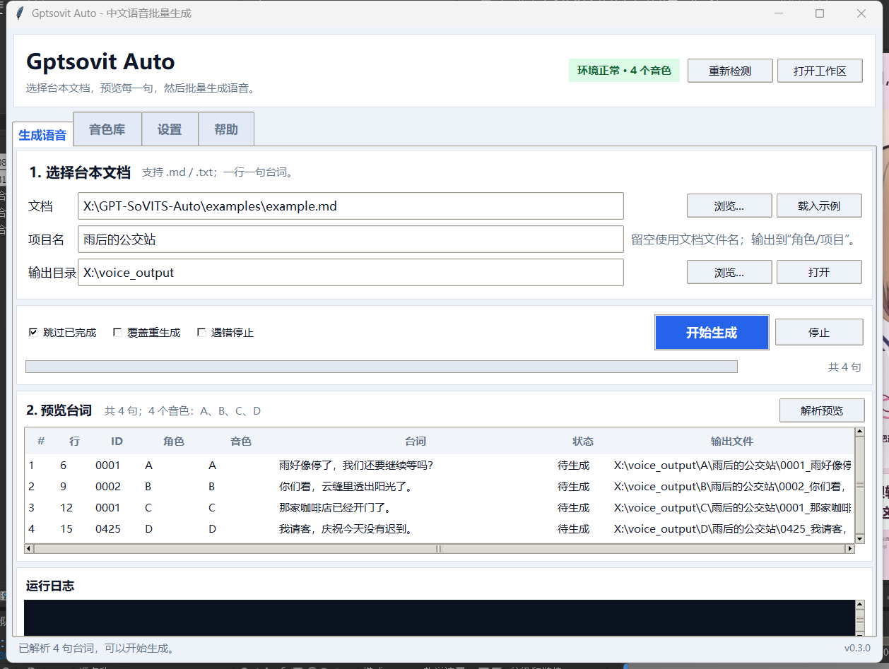
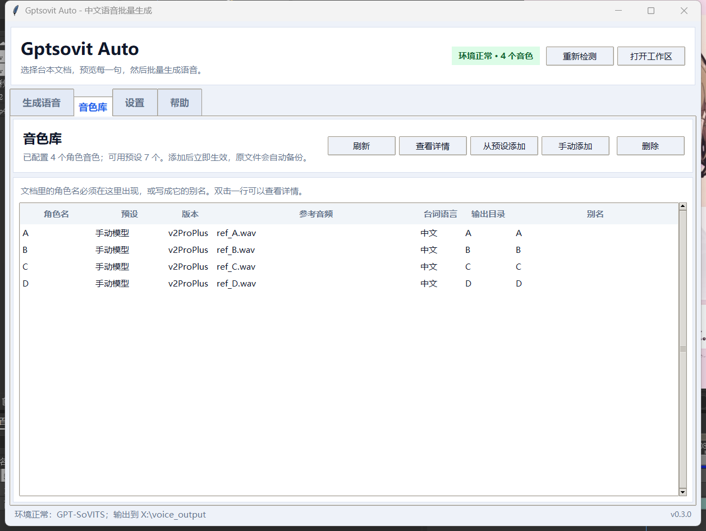
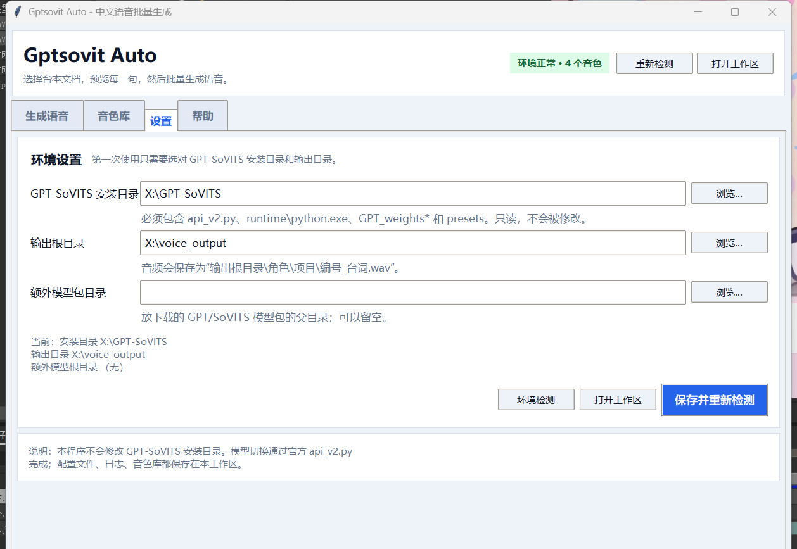

# GPT-SoVITS Auto

Batch text-to-speech for GPT-SoVITS, driven by a Markdown or plain-text script.

GPT-SoVITS Auto reads a dialogue document, resolves each speaker to a GPT/SoVITS
voice plus reference audio, calls the official GPT-SoVITS HTTP API, and writes
one WAV per line into a per-character/per-project folder. The GPT-SoVITS
installation is treated as **read-only**. A beginner-friendly Tkinter desktop
UI is included (`run_ui.bat`); the CLI remains available for automation.

[中文说明](README.md)

> **No voice models, GPT/SoVITS weights, or reference audio are bundled.**
> Download and configure your own legally obtained models. A/B/C/D in the
> examples are placeholders; they do not refer to any specific work or character.

## Screenshots

> The screenshots use demo paths (`X:\...`) and placeholder voices A/B/C/D, not
> a real user directory or real characters.







## Why the HTTP API instead of clicking the WebUI

The TTS WebUI does not expose a generation endpoint, and its preset/history
actions write files inside the GPT-SoVITS directory. This tool starts
`api_v2.py` with a **workspace copy** of `tts_infer.yaml` and uses the same
inference pipeline as the WebUI:

1. `GET /set_sovits_weights`
2. `GET /set_gpt_weights`
3. `GET /set_refer_audio`
4. `POST /tts`

The API listens on `127.0.0.1:9880` by default and is stopped after the run.

## Requirements

- Windows 10/11
- A working GPT-SoVITS installation (`api_v2.py`, `runtime\python.exe`,
  `GPT_weights*`, `SoVITS_weights*`, `presets`, pretrained models)
- Your own GPT/SoVITS weights and reference audio
- Python 3.9+ only if you do not use the GPT-SoVITS runtime
- The workspace dependencies: `pip install -r requirements.txt`

The simplest layout is to put this workspace next to the GPT-SoVITS folder:

```text
D:\AI\
├─ GPT-SoVITS\
└─ GPT-SoVITS-Auto\
   ├─ run.bat
   ├─ config\settings.yaml
   └─ voices\voices.yaml
```

`run.bat` discovers the runtime in this order:

1. `%GPT_SOVITS_HOME%\runtime\python.exe`
2. `..\GPT-SoVITS-v2pro-20250604-nvidia50\runtime\python.exe`
3. `..\GPT-SoVITS\runtime\python.exe`
4. `python` on `PATH`

For a custom location:

```bat
set GPT_SOVITS_HOME=D:\path\to\GPT-SoVITS
run.bat init --install "%GPT_SOVITS_HOME%"
```

## Desktop UI

Double-click `run_ui.bat`. It looks for `pythonw.exe` in the same order as
`run.bat`, then opens a four-tab window:

- **Generate**: choose a document, preview every line, start/stop generation,
  open the output folder.
- **Voices**: view configured voices, add from a preset, add manually, remove.
- **Settings**: install root, output root, extra model roots; saves with a
  backup and reloads the environment.
- **Help**: short beginner instructions.

The UI uses `pythonw.exe`, so there is no console. If the window does not
appear, check `logs\ui-crash.log` or run `run.bat --version` in a terminal.

## Quick Start

```bat
run_ui.bat
rem or the CLI:
run.bat init
run.bat check
run.bat voices scan
run.bat voices add
run.bat parse --doc examples\example.md
run.bat run --doc examples\example.md --project sample
```

`voices.yaml` is empty by default. Add A/B/C/D (or any names you use in the
document) before running the example.

`voices add` is an interactive wizard. It can use an existing WebUI preset or
a manual GPT/SoVITS/ref-audio combination, validates the result, and backs up
`voices.yaml` before writing.

Non-interactive add:

```bat
run.bat voices add --key A --preset "your-preset" --yes
run.bat voices add --key B ^
  --gpt "D:\models\B.ckpt" ^
  --sovits "D:\models\B.pth" ^
  --ref-audio "D:\models\ref_B.wav" ^
  --prompt-text "the exact transcript of the reference audio" ^
  --prompt-lang zh --text-lang zh --yes
```

Use `--dry-run` to validate without writing. `run.bat voices remove --key X`
removes a voice and keeps a timestamped backup.

## Dialogue Format

One line per utterance; UTF-8 (with/without BOM) and GB18030 are supported.

```markdown
A：雨好像停了，我们还要继续等吗？
B：你们看，云缝里透出阳光了。
[0001] C：那家咖啡店已经开门了。
[04:25] D：我请客，庆祝今天没有迟到。
0001 | A | The pipe format also works.
```

A Markdown heading sets the current speaker:

```markdown
## A
雨好像停了。
- 我们还要继续等吗？
```

Optional frontmatter:

```markdown
---
project: rainy-bus-stop
default_voice: A
text_lang: zh
---
```

Output:

```text
<output_root>\<voice_dir>\<project>\<id>_<text>.wav
```

IDs come from `[0001]`, then timecodes (`[04:25]` -> `0425`), then a
zero-padded line index. Existing files are never overwritten unless they are
owned by the current project manifest; resume is on by default.

## Read-only Guarantee

- API config is `config\tts_infer.local.yaml`, never the install config.
- API is launched with `-B` and a workspace `pycache_prefix`.
- The script only writes the workspace, the configured output root, and the
  GPT-SoVITS process's own temporary/cache files; it never asks the WebUI to
  save presets or generated audio.
- `PathGuard` rejects writes inside the installation directory.

If you change model weights, GPT-SoVITS rewrites the `-c` config it was given;
that is why the workspace copy exists.

## Useful Commands

| Command | Purpose |
|---|---|
| `run_ui.bat` | Open the desktop UI |
| `run.bat init` | Create default files; never overwrites existing ones without `--force` |
| `run.bat check` | Validate paths, voices, VRAM, and API status |
| `run.bat voices list` | Show configured voices |
| `run.bat voices scan` | Discover presets, weight pairs, and model packs |
| `run.bat voices add` | Add a voice interactively |
| `run.bat voices remove --key X` | Remove a voice (with backup) |
| `run.bat parse --doc ...` | Parse and preview without generating |
| `run.bat run --doc ...` | Generate WAVs |
| `run.bat server start/status/stop` | Manage the API process |

See [README.md](README.md) for the complete Chinese reference, including GPU
and troubleshooting notes.

## Limitations

- One input line = one WAV; SRT/ASS is not parsed.
- No automatic reference-audio generation or prompt transcription.
- Model versions v3/v4 need a `prompt_text` for every manual voice.
- Windows is the primary target; the Python code avoids platform-specific
  APIs but has only been tested on Windows.
- The desktop UI handles one document at a time; use the CLI for multi-document
  batch runs.

## Tests

The workspace has 40 unit tests covering parsing, naming, settings, voice
discovery/editing, server-config generation, and WAV validation:

```bat
"%GPT_SOVITS_HOME%\runtime\python.exe" -B -m unittest discover -s tests -v
```

`voices scan --json` is intended for scripting and prints only JSON.

The UI was smoke-tested end-to-end: preview, generation of the four-line
example, resume skip, preset/manual add/remove, settings reload, and
`run_ui.bat` launching `pythonw.exe`.

## License

MIT. See [LICENSE](LICENSE). GPT-SoVITS itself is a separate project with its
own license; this workspace does not vendor its code or models.
